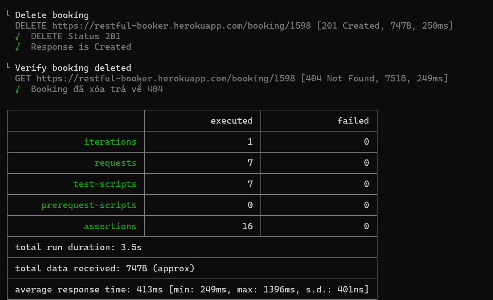

# Restful Booker API Testing

A portfolio API testing project using **Postman**, **Newman**, **Newman HTML Extra**, and **GitHub Actions**. It demonstrates CRUD testing, positive/negative scenarios, parameter validation, authentication checks, data-driven test execution, and CI automation.

## 1. Project scope

- **System under test:** [Restful Booker](https://restful-booker.herokuapp.com/)
- **API base URL:** `https://restful-booker.herokuapp.com`
- **Coverage:** authentication, booking creation, retrieval, filtering, full/partial updates, deletion, and invalid inputs
- **Test design:** at least 40 manually exercised test cases documented in `test-cases/API_TestCases.xlsx` (including negative and boundary cases)
- **Automated smoke suite:** 7 sequential requests in the Postman folder `CI Smoke`
- **Tools:** Postman, Newman, `newman-reporter-htmlextra`, GitHub Actions

> Restful Booker is a public demo API and may reset data. New test data is created during the smoke run; booking IDs must not be hard-coded.

## 2. API endpoints covered

| Method | Endpoint | Purpose |
|---|---|---|
| `POST` | `/auth` | Create authentication token |
| `GET` | `/booking` | List and filter booking IDs |
| `GET` | `/booking/{id}` | Read booking details |
| `POST` | `/booking` | Create a booking |
| `PUT` | `/booking/{id}` | Replace a booking |
| `PATCH` | `/booking/{id}` | Partially update a booking |
| `DELETE` | `/booking/{id}` | Delete a booking |

## 3. Repository structure

```text
api-testing-restful-booker/
├── README.md
├── .gitignore
├── postman/
│   ├── restful-booker.postman_collection.json
│   ├── restful-booker.postman_environment.json
│   └── data/
│       └── bookings.csv
├── test-cases/
│   └── API_TestCases.xlsx
├── reports/
│   └── newman-local-summary.png
└── .github/
    └── workflows/
        └── api-tests.yml
```

## 4. Run tests using Postman

1. Import `postman/restful-booker.postman_collection.json` and `postman/restful-booker.postman_environment.json`.
2. Select the **restful-booker** environment.
3. Configure `baseUrl`, `username`, and `password` locally. Do not commit credentials or authentication tokens.
4. Open **CI Smoke** → **Run**, select **Functional**, one iteration, and the selected environment.
5. Confirm results for the seven requests, including `DELETE` returning `201` and the subsequent `GET` returning `404`.

The collection scripts save the new `token` and `bookingId` dynamically.

## 5. Run tests using Newman

Install Node.js LTS, then:

```bash
npm install -g newman newman-reporter-htmlextra
```

From the repository root, run the smoke suite (replace `<demo-password>` locally):

```bash
newman run postman/restful-booker.postman_collection.json -e postman/restful-booker.postman_environment.json --folder "CI Smoke" --env-var "baseUrl=https://restful-booker.herokuapp.com" --env-var "username=admin" --env-var "password=<demo-password>" -r cli,htmlextra --reporter-htmlextra-export reports/report.html
```

Use `mkdir reports` first if the directory does not exist. Do not commit generated reports containing sensitive values.

### Data-driven test

Run the `Day 32 - Data Driven` folder against three CSV rows:

```bash
newman run postman/restful-booker.postman_collection.json --folder "Day 32 - Data Driven" -d postman/data/bookings.csv -n 3 --env-var "baseUrl=https://restful-booker.herokuapp.com"
```

Data: `An Nguyen (100, true)`, `Binh Le (0, false)`, and `Chi Pham (99999, true)`.

## 6. Verified test results

The numbers below come from the actual **GitHub Actions** smoke-suite run on **2026-11-20**:

| Metric | Result |
|---|---:|
| Iterations | 1 |
| Requests executed | **7** |
| Assertions executed | **16** |
| Failed assertions | **0** |
| Workflow | **Success** |

[Open the successful GitHub Actions run](https://github.com/halovie123/api-testing-restful-booker/actions/runs/44709803167)



For the full manual/exploratory results, see the **Actual**, **Result**, and **Notes** columns in `test-cases/API_TestCases.xlsx`. Individual exploratory tests may fail when a response differs from the hypothesized expected status.

## 7. Defects and API behavior observations

The following are **observations or bug candidates**, not confirmed product defects. A failing assertion by itself does not prove a bug: expected behavior must be supported by requirements or an API contract.

| Observation | Actual behavior observed | Follow-up |
|---|---|---|
| Invalid login credentials | `/auth` may respond with HTTP `200` and `{ "reason": "Bad credentials" }`, without a token | Verify intended error-status contract |
| Booking ID not found | PUT/PATCH against a missing booking ID can return `405` instead of a proposed `404` | Confirm documented behavior and test with valid authentication |
| Token-based update refused | Some earlier PUT/PATCH attempts returned `403` when using a Cookie token | Distinguish invalidated token, header configuration, and a reproducible API defect |
| Demo database reset | A booking created earlier can later be absent | Recreate test data and avoid depending on old IDs |

Record reproducible, confirmed defects and their evidence in the test-case workbook or a dedicated bug log; do not invent bug IDs, severity, or results.

## 8. Continuous integration

The workflow in `.github/workflows/api-tests.yml` runs the **CI Smoke** folder with Newman on `push` to `main` or via **Run workflow**. It uploads the **newman-report** artifact even when an assertion fails, provided the report file is generated.

For non-demo systems, store credentials in **GitHub Actions Secrets**; never place real passwords or tokens in source control.

## 9. References

- [Restful Booker API](https://restful-booker.herokuapp.com/)
- [Postman documentation](https://learning.postman.com/)
- [Newman CLI](https://learning.postman.com/docs/collections/using-newman-cli/command-line-integration-with-newman/)
- [GitHub Actions](https://docs.github.com/en/actions)
